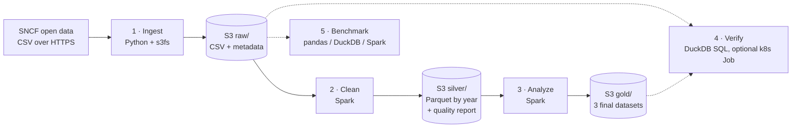

# TGV punctuality pipeline (2018-2026)

Batch data pipeline on SNCF open data: raw ingestion to S3, cleaning and aggregation with Spark into
partitioned Parquet layers, and an **independent DuckDB verification that fails the run on any mismatch**.

**Authors:** LIBAMA David, CATTIN-QUEST Julian

**Stack:** Python · PySpark · DuckDB · SQL · S3 (Onyxia) · Parquet · Kubernetes

## Question

Which TGV routes had the highest share of late arrivals between 2018 and 2026, and how did punctuality
and the causes of delay evolve year by year? Rates are recomputed from train counts (not averaged
percentages) and checked by a second engine.

## Architecture



- **Ingest:** the file is stored untouched on S3 with its size, SHA-256 and download time. The step
  refuses a file outside 1-5 MB and never overwrites an existing snapshot, so results stay tied to one snapshot.
- **Clean and analyze:** Spark reads the multi-line CSV, casts every column explicitly, counts each quality
  rule before applying it, then writes Parquet partitioned by year (silver) and three aggregated datasets
  (gold). DataFrame API only, no Python UDF.
- **Verify:** a second engine, with separately written SQL, recomputes the rates from the raw CSV (not from
  Spark's output) and exits with an error on any difference.

## Key results

Rates are computed as sum(late arrivals) / sum(planned - cancelled trains) over the period, so busy months
weigh more than quiet ones.

| Worst routes (observed at least 24 months) | Trains run | Late at arrival |
|---|---:|---:|
| Italie - Paris Lyon | 6,897 | 33.0 % |
| Chambéry - Paris Lyon | 21,804 | 27.3 % |
| Lyon Part Dieu - Lille | 28,919 | 26.5 % |
| Mâcon Loché - Paris Lyon | 22,344 | 26.4 % |
| Lyon Part Dieu - Marne la Vallée | 31,206 | 25.4 % |
| Paris Est - Stuttgart | 12,353 | 23.6 % |

| Year | Trains run | Late |
|---|---:|---:|
| 2018 | 383,053 | 17.80 % |
| 2019 | 368,835 | 13.83 % |
| 2020 | 250,584 | 12.40 % |
| 2021 | 366,568 | 11.28 % |
| 2022 | 430,843 | 14.33 % |
| 2023 | 430,062 | 14.68 % |
| 2024 | 439,992 | 13.69 % |
| 2025 | 434,624 | 15.05 % |
| 2026 (Jan-Sep) | 318,473 | 18.73 % |

- The least punctual routes are long cross-country or international services arriving in Paris Lyon or
  crossing Lyon: one train in three from Italy arrives late.
- Punctuality improved from 17.8 % late arrivals in 2018 to 11.3 % in 2021, then degraded to 15.1 % in 2025
  while traffic exceeded its 2018 level.
- Causes shifted between 2018 and 2025: external causes fell from 26.1 % to 19.8 % of delays, while traffic
  management rose from 21.2 % to 24.5 % and station management from 5.4 % to 9.0 %.
- **Independent verification passed:** DuckDB recomputed the 18 year-service rows and the 130 route rows
  from the raw CSV, with identical counts and a maximum rate difference of 0.0 (tolerance 1e-9).

## Data quality

12,907 raw records become 12,834 clean records. Every rule is counted on the raw data before being applied,
and the counts are stored in `processed/quality_report/quality_report.json`.

| Issue (real example) | Rows | Treatment |
|---|---:|---|
| Free-text comments with line breaks and `;` inside quotes (15,425 physical lines for 12,907 records) | 698 comments | multi-line CSV parsing, comment columns dropped |
| Two comment columns entirely empty | 12,907 | columns dropped |
| No train planned, e.g. lockdown months | 73 | rows dropped (a rate over 0 trains is undefined) |
| Same route and month under both National and International (2025-07 to 2025-09) | 84 | kept: not duplicates, summed across services |
| Negative count of trains more than 30 min late | 43 | set to NULL |
| Negative average delays (two columns) | 2 + 8 | set to NULL |
| More trains > 15 min late than trains late at arrival | 31 | kept and flagged, column not used in rates |
| Cause percentages all zero (272) or not summing to 100 (9) | 281 | causes set to NULL, excluded from the cause analysis only |

One decision matters for the results: de-duplicating on (month, origin, destination) would silently delete
42 records of real traffic, because the true key includes the service.

## Engine benchmark

Same query (parse the CSV, filter, yearly late-arrival rate) on three engines, 5 runs each, measured on a
laptop with a local copy of the file. The three engines return identical rates.

| Engine | First run (s) | Median of 5 runs (s) |
|---|---:|---:|
| pandas | 0.354 | 0.014 |
| DuckDB | 0.072 | 0.032 |
| Spark (`local[*]`) | 0.729 | 0.189 (+ 3.98 s session start-up) |

At 2.9 MB, pandas and DuckDB are about ten times faster than Spark. Spark is kept for the main
transformation because the same code scales to a cluster without rewriting and writes partitioned Parquet
to S3 natively. DuckDB's speed and zero start-up make it the right tool for the independent check.

## Dataset

*Régularité mensuelle TGV par liaisons* (SNCF Voyageurs / AQST) -
<https://ressources.data.sncf.com/explore/dataset/regularite-mensuelle-tgv-aqst/> -
Open Database License (ODbL). 2.9 MB, one CSV, 12,907 rows x 26 columns: one row per month, service and
route (130 routes between 59 stations, 2018-01 to 2026-09). The snapshot's download time, size and SHA-256
are recorded in `raw/_ingest_metadata.json` at ingestion.

## Reproduction

**Prerequisites:** an Onyxia account with a personal S3 bucket; a *Jupyter-PySpark* or
*VSCode-PySpark* service (Python >= 3.10, Spark >= 3.5, Java, S3 variables `AWS_*` pre-set);
`pip install -r src/requirements.txt`; `kubectl` (already in the service) for the optional job.

**S3 paths** (bucket = `$S3_BUCKET`, your Onyxia bucket):

| Layer | Path |
|---|---|
| Raw | `s3://$S3_BUCKET/bigdata_project/raw/` (CSV snapshot + `_ingest_metadata.json`) |
| Clean (Parquet, by year) | `s3://$S3_BUCKET/bigdata_project/processed/silver/tgv_clean/` |
| Final datasets | `s3://$S3_BUCKET/bigdata_project/processed/gold/{route_punctuality,yearly_punctuality,delay_causes_by_year}/` |
| Reports | `s3://$S3_BUCKET/bigdata_project/processed/{quality_report,verification,benchmark}/` |

Commands (terminal of the Onyxia PySpark service):

```bash
git clone https://github.com/libama04/bigdata_project.git && cd bigdata_project
pip install -r src/requirements.txt
export S3_BUCKET=<your-onyxia-bucket>             # AWS_* variables are already set by Onyxia
./src/run_all.sh                                  # runs steps 1 to 5 in order
```

| Step | Script | Tool | Output |
|---|---|---|---|
| 1 | `src/01_ingest_raw.py` | Python + s3fs | raw CSV on S3 (checks the 1-5 MB limit, sha256) |
| 2 | `src/02_clean_spark.py` | Spark | clean Parquet + data-quality report |
| 3 | `src/03_analyze_spark.py` | Spark | 3 final datasets |
| 4 | `src/04_verify_duckdb.py` | DuckDB (`src/sql/`) | recomputes rates from the raw CSV, fails on mismatch |
| 5 | `src/05_benchmark.py` | pandas / DuckDB / Spark | timings of the alternatives |

- **Restart:** every step overwrites its own output, so re-run the script, or resume with
  `./src/run_all.sh 3` (from step 3). Step 1 keeps the existing snapshot; the source is updated
  monthly, use `python src/01_ingest_raw.py --force` to refresh it (figures will then change).
- **Expired S3 token:** restart the Onyxia service (or renew the `AWS_*` variables) and re-run.
- **Optional Kubernetes job** (step 4 in a separate pod): commands in `k8s/verify-job.yaml`.
- **Local run without S3:** `export DATA_ROOT=/tmp/tgv` instead of `S3_BUCKET`.
- **Evidence:** `evidence/README.md` lists the numbered screenshots that document each step.

## With 100 times more data

At about 290 MB and 1.3 million records the results would be computed the same way, but several
engineering choices would change. These are expectations, not measurements:

- **Raw layout:** a single CSV with quoted line breaks cannot be split, so Spark reads it with one task.
  Ingest one file per month under `raw/year=/month=/` and convert to Parquet immediately.
- **Ingestion:** a streamed, incremental load of new months only, instead of holding the file in memory.
- **Outputs:** partitioned writes instead of `coalesce(1)` and the global ranking window.
- **Engines:** pandas would be dropped first; DuckDB would very likely still handle this size on one node;
  Spark's start-up cost becomes negligible and running executors on the cluster starts to pay off.
- **Verification:** still a full recomputation at this size; much beyond it, sampled routes plus invariant
  checks (row counts, totals).

## Limitations

- The data is already aggregated by month and route: no individual trains, time of day or delay distributions.
- 2026 covers January to September only, and its cause breakdown departs sharply from every previous year,
  which suggests a change in the source's classification: it is reported but not interpreted.
- "Late" follows the operator's own, self-reported threshold.
- The verification shares the two business rules of the main job, so it validates the computation, not the
  choice of rules.
- Figures hold for the stored snapshot only; the source is updated monthly.
